# InvoiSys — Documentação Funcional

O que o sistema faz, para quem e com quais regras, do ponto de vista de quem usa. O
**como** (camadas, decisões, schema) está em
[decisoes-arquiteturais.md](decisoes-arquiteturais.md) e
[modelagem-de-dominio.md](modelagem-de-dominio.md); os contratos do Jira e do provedor de
IA estão em [contratos-integracao.md](contratos-integracao.md).

Tudo o que está aqui foi conferido contra o código de `src/` e `frontend/src/`. Onde o
comportamento ainda não está completo, o texto diz isso explicitamente.

## Índice

1. [Visão do produto](#1-visão-do-produto)
2. [Atores e permissões](#2-atores-e-permissões)
3. [Diagrama de casos de uso](#3-diagrama-de-casos-de-uso)
4. [Requisitos funcionais e não funcionais](#4-requisitos)
5. [Diagramas de sequência](#5-diagramas-de-sequência)
6. [Diagramas de estados](#6-diagramas-de-estados)
7. [Regras de negócio](#7-regras-de-negócio)
8. [Telas](#8-telas)

---

## 1. Visão do produto

**Problema.** A cada Release, a InvoiSys precisa comunicar aos clientes o que mudou no
produto. Hoje esse texto é escrito à mão a partir das histórias do Jira, que estão em
linguagem técnica, com qualidade irregular e espalhadas entre descrição da história e
subtarefas. Escrever o comunicado toma tempo e o resultado varia de Release para Release.

**Solução.** O InvoiSys Release Notes busca as histórias de uma Release direto na API do
Jira, agrupa as semelhantes, classifica cada grupo em uma categoria fixa e reescreve o
texto em linguagem de negócio usando um modelo de IA. O resultado é um rascunho de
comunicado que **nunca sai sem revisão humana**: alguém edita, exclui ou aprova item por
item, e só a versão aprovada pode ser exportada (hoje em Markdown).

**Quem usa.** A equipe que fecha Releases na InvoiSys: o *release manager*, que processa,
revisa, aprova e exporta os comunicados, e o *administrador*, que além disso gerencia os
acessos da equipe. O cliente final da InvoiSys não acessa o sistema: ele recebe o
comunicado exportado.

---

## 2. Atores e permissões

| Ator | Tipo | Papel no sistema |
|---|---|---|
| **release_manager** | humano (`Usuario.Papel = "release_manager"`) | Processa Releases, revisa itens, aprova, reprova, reabre e exporta comunicados |
| **admin** | humano (`Usuario.Papel = "admin"`) | Tudo o que o release_manager faz, mais cadastrar, listar e desativar usuários |
| **Jira** | sistema externo | Fonte única das histórias da Release (busca por `fixVersion`), via API REST com e-mail + API token |
| **Provedor de IA** | sistema externo | OpenRouter (padrão) ou OpenAI, escolhido por `Llm__Provedor`. Agrupa, categoriza, reescreve e gera título e resumo |

Os papéis válidos são só esses dois (`Usuario.PapelEhValido`). A única policy nomeada da
API é `Admin` (`RequireRole("admin")`, em `Program.cs`); as demais rotas protegidas exigem
apenas um token JWT válido de usuário **ativo** (o token de usuário desativado é recusado
em `OnTokenValidated`, mesmo antes de expirar).

### Permissões por rota

Base: `/api/v1`. "Autenticado" = qualquer usuário ativo com token, de qualquer papel.

| Método | Rota | Anônimo | release_manager | admin | Arquivo |
|---|---|:-:|:-:|:-:|---|
| GET | `/health` (fora de `/api/v1`) | sim | sim | sim | `Program.cs` |
| POST | `/auth/login` | sim | sim | sim | `AuthEndpoints.cs` |
| POST | `/auth/logout` | sim | sim | sim | `AuthEndpoints.cs` |
| POST | `/auth/forgot-password` | sim | sim | sim | `AuthEndpoints.cs` |
| POST | `/auth/resend-forgot-password` | sim | sim | sim | `AuthEndpoints.cs` |
| POST | `/auth/reset-password` | sim | sim | sim | `AuthEndpoints.cs` |
| GET | `/branding/highlights` | sim | sim | sim | `BrandingEndpoints.cs` |
| GET | `/auth/me` | — | sim | sim | `AuthEndpoints.cs` |
| GET | `/dashboard` | — | sim | sim | `DashboardEndpoints.cs` |
| GET | `/releases` | — | sim | sim | `ReleaseEndpoints.cs` |
| GET | `/releases/{chave}` | — | sim | sim | `ReleaseEndpoints.cs` |
| GET | `/releases/{chave}/historias` | — | sim | sim | `ReleaseEndpoints.cs` |
| POST | `/releases/{chave}/processar` | — | sim | sim | `ReleaseEndpoints.cs` |
| POST | `/releases/{chave}/aprovar` | — | sim | sim | `RevisaoEndpoints.cs` |
| POST | `/releases/{chave}/reprovar` | — | sim | sim | `RevisaoEndpoints.cs` |
| POST | `/releases/{chave}/reabrir` | — | sim | sim | `RevisaoEndpoints.cs` |
| PATCH | `/releases/{chave}/itens/{itemId}` | — | sim | sim | `ItemComunicadoEndpoints.cs` |
| POST | `/releases/{chave}/itens/{itemId}/excluir` | — | sim | sim | `ItemComunicadoEndpoints.cs` |
| POST | `/releases/{chave}/itens/{itemId}/reincluir` | — | sim | sim | `ItemComunicadoEndpoints.cs` |
| POST | `/releases/{chave}/exportar` | — | sim | sim | `ExportacaoEndpoints.cs` |
| GET | `/exportacoes` | — | sim | sim | `ExportacaoEndpoints.cs` |
| GET | `/exportacoes/{id}` | — | sim | sim | `ExportacaoEndpoints.cs` |
| POST | `/usuarios` | — | não (403) | sim | `UsuarioEndpoints.cs` (policy `Admin`) |
| GET | `/usuarios` | — | não (403) | sim | `UsuarioEndpoints.cs` (policy `Admin`) |
| POST | `/usuarios/{id}/desativar` | — | não (403) | sim | `UsuarioEndpoints.cs` (policy `Admin`) |

"—" = sem token a resposta é `401`. Jira e provedor de IA não chamam a API: são chamados
por ela (o Jira em `/historias` e `/processar`; a IA só em `/processar`).

No front, as telas `/usuarios` e `/usuarios/novo` ficam atrás de `RotaAdmin`, que mostra
"Sem permissão" para quem não é admin. Isso é só conveniência de interface: quem garante a
regra é a policy `Admin` da API.

---

## 3. Diagrama de casos de uso

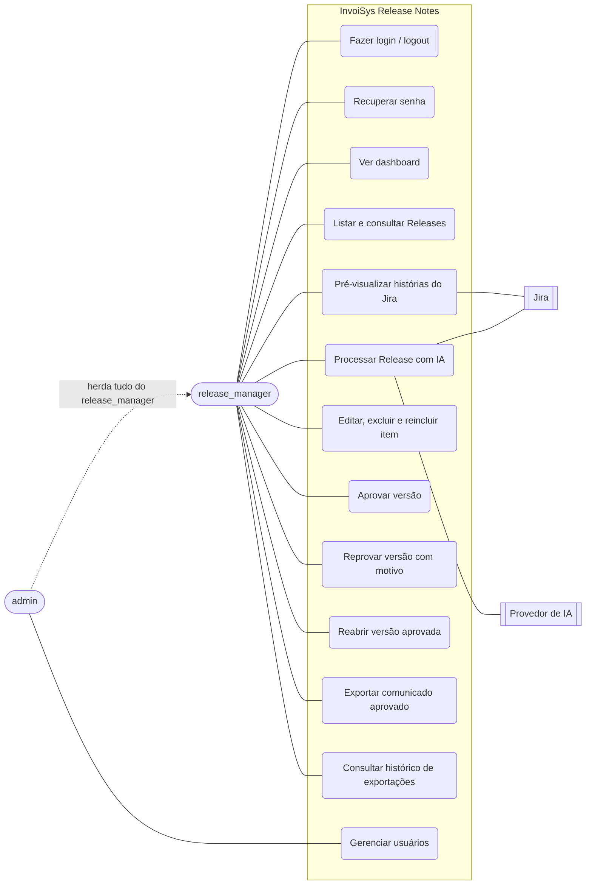

`admin` herda todos os casos de uso do `release_manager` (a API não restringe nenhuma rota
de Release por papel) e tem, só ele, "Gerenciar usuários" (cadastrar, listar, desativar).

---

## 4. Requisitos

### 4.1 Requisitos funcionais

| Id | Requisito | Rota que atende |
|---|---|---|
| RF-01 | Autenticar o usuário com e-mail e senha e devolver um token JWT | `POST /api/v1/auth/login` |
| RF-02 | Devolver os dados do usuário autenticado | `GET /api/v1/auth/me` |
| RF-03 | Encerrar a sessão (o cliente descarta o token; o servidor não guarda sessão) | `POST /api/v1/auth/logout` |
| RF-04 | Enviar link de redefinição de senha sem revelar se o e-mail existe | `POST /api/v1/auth/forgot-password` |
| RF-05 | Reenviar o link de redefinição, invalidando o anterior | `POST /api/v1/auth/resend-forgot-password` |
| RF-06 | Trocar a senha com o token recebido (uso único, válido por 30 min) | `POST /api/v1/auth/reset-password` |
| RF-07 | Exibir os destaques ativos da tela de login | `GET /api/v1/branding/highlights` |
| RF-08 | Consultar as histórias de uma Release direto no Jira, sem rodar a IA | `GET /api/v1/releases/{chave}/historias` |
| RF-09 | Processar uma Release: buscar no Jira, agrupar, categorizar, reescrever e gerar título e resumo, persistindo o resultado | `POST /api/v1/releases/{chave}/processar` |
| RF-10 | Listar as Releases já processadas, com filtro opcional por status | `GET /api/v1/releases?status=` |
| RF-11 | Detalhar uma Release: histórias, versões por público com seus itens, e histórico de execuções do pipeline | `GET /api/v1/releases/{chave}` |
| RF-12 | Editar o texto de um item do comunicado | `PATCH /api/v1/releases/{chave}/itens/{itemId}` |
| RF-13 | Excluir um item do comunicado (com motivo opcional), sem apagar o registro | `POST /api/v1/releases/{chave}/itens/{itemId}/excluir` |
| RF-14 | Reincluir um item excluído | `POST /api/v1/releases/{chave}/itens/{itemId}/reincluir` |
| RF-15 | Aprovar a versão de um público, registrando quem aprovou e quando | `POST /api/v1/releases/{chave}/aprovar` |
| RF-16 | Reprovar a versão de um público, com motivo obrigatório | `POST /api/v1/releases/{chave}/reprovar` |
| RF-17 | Reabrir a revisão de uma versão aprovada | `POST /api/v1/releases/{chave}/reabrir` |
| RF-18 | Exportar o comunicado aprovado de um público (hoje só `markdown`; `html` e `pdf` respondem 422) | `POST /api/v1/releases/{chave}/exportar` |
| RF-19 | Consultar o histórico de exportações (paginado, filtro por público, busca por chave ou título) e o conteúdo de uma exportação | `GET /api/v1/exportacoes`, `GET /api/v1/exportacoes/{id}` |
| RF-20 | Exibir indicadores (aprovadas, aguardando revisão, falharam, exportações), série dos últimos dias, Releases recentes e qualidade da IA (itens gerados, editados, excluídos) | `GET /api/v1/dashboard` |
| RF-21 | Cadastrar usuário com nome, e-mail, papel e senha inicial (só admin) | `POST /api/v1/usuarios` |
| RF-22 | Listar usuários (só admin) | `GET /api/v1/usuarios` |
| RF-23 | Desativar usuário, exceto a própria conta (só admin) | `POST /api/v1/usuarios/{id}/desativar` |
| RF-24 | Criar o administrador inicial no primeiro boot, se não houver nenhum usuário | sem rota: `AdminInicialSemeador`, no startup |

Limitações atuais, conferidas no código:

- O pipeline gera hoje **só a versão `cliente`** (`Release.ConcluirProcessamento` usa
  `PublicoAlvo.Cliente` por padrão). O modelo e as rotas de revisão/exportação já aceitam
  os quatro públicos (`cliente`, `comercial`, `suporte`, `interno`), mas as outras versões
  ainda não são geradas.
- A tela "Histórico de Envios" do front ainda usa dados de exemplo
  (`frontend/src/data/sentHistory.mock.js`), não a rota do RF-19.
- O envio de e-mail do RF-04/RF-05 ainda não tem SMTP: o adapter `EnvioEmailPendente`
  escreve o link no log da API (nível Warning).

### 4.2 Requisitos não funcionais

| Id | Requisito | Onde está |
|---|---|---|
| RNF-01 | Toda rota fora de login, recuperação de senha, logout, destaques e `/health` exige JWT Bearer válido de usuário ativo | `Program.cs`, `*Endpoints.cs` |
| RNF-02 | Senhas guardadas com hash Argon2id; login com e-mail inexistente também calcula hash (resposta sem diferença de tempo que revele o e-mail) | `Argon2idHashSenha`, `Autenticacao.HashFicticio` |
| RNF-03 | Token JWT expira em `Auth__Jwt__ExpiracaoHoras` (padrão 8 h); chave de no mínimo 32 caracteres, sem ela a API não sobe | `AuthOptions.Validar()` |
| RNF-04 | Limite de tentativas de login por IP (padrão 5 a cada 60 s, resposta 429 com `Retry-After`) | `ConfiguracaoHttp.AddLimiteDeLogin` |
| RNF-05 | Limite de pedidos de recuperação de senha por IP (padrão 5 a cada 15 min) e intervalo mínimo entre e-mails para o mesmo usuário (padrão 60 s) | `ConfiguracaoHttp`, `RecuperacaoSenha` |
| RNF-06 | Toda chamada ao Jira e ao provedor de IA tem retry, timeout por tentativa e circuit breaker (Jira: 2 retries, 15 s por tentativa, 60 s no total; IA: 2 retries, 60 s por tentativa, 180 s no total) | `Infrastructure/DependencyInjection.cs` |
| RNF-07 | Sem credencial do Jira ou da IA, a API sobe e responde `501` nas rotas que dependem delas, em vez de falhar no boot | `JiraClientPendente`, `ProviderPendente` (ADR-014) |
| RNF-08 | Falha de integração externa vira `502` com mensagem do domínio; corpo da resposta externa vai só para o log | `ExcecoesDeIntegracao.cs` (ADR-013) |
| RNF-09 | Uma Release não é processada duas vezes ao mesmo tempo: a segunda chamada recebe `409` antes de gastar chamadas pagas | `PostgresBloqueioProcessamento` (ADR-031) |
| RNF-10 | Erros da API seguem Problem Details (RFC 7807); validação de formato na borda responde `422` com `errors` por campo | `AddProblemDetails`, `Validacao/` (ADR-028) |
| RNF-11 | CORS liberado só para as origens de `Cors__Origens__N` | `ConfiguracaoHttp.AddCorsConfiguravel` |
| RNF-12 | Persistência em PostgreSQL 16; migrations aplicadas no boot só quando `Database__MigrarAoIniciar=true` | `Program.cs` (ADR-011, ADR-016) |
| RNF-13 | `GET /health` para verificação de disponibilidade; a imagem Docker usa o próprio binário como health check (`--healthcheck`) | `Program.cs`, `Dockerfile` |
| RNF-14 | Contrato OpenAPI e Swagger UI disponíveis só em ambiente Development | `Program.cs` |
| RNF-15 | Nenhum segredo no repositório: credenciais só por variável de ambiente / App Settings | `.env.example`, [deploy.md](deploy.md) |
| RNF-16 | Prompts do pipeline versionados como arquivo em `prompts/`, nunca em string no código | `PromptLoader` (ADR-005) |
| RNF-17 | CI reprova PR sem build, formatação (`dotnet format --verify-no-changes`), testes, lint e build do front | `.github/workflows/ci.yml` |

---

## 5. Diagramas de sequência

### 5.1 Processar Release

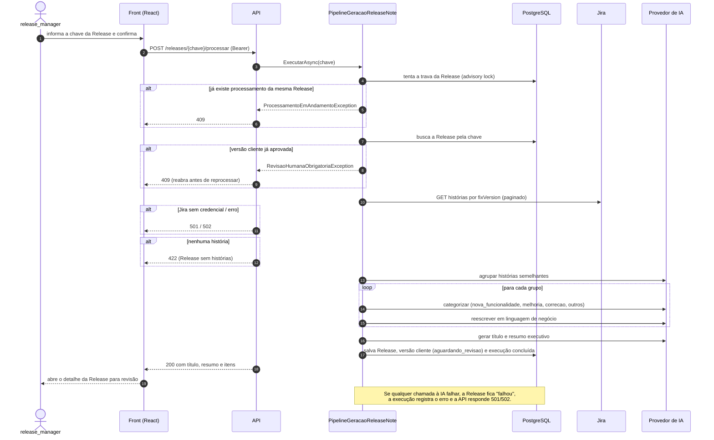

### 5.2 Revisar e aprovar

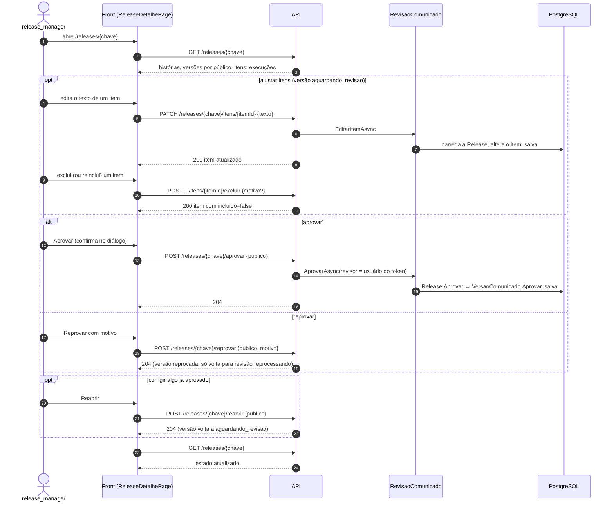

### 5.3 Exportar

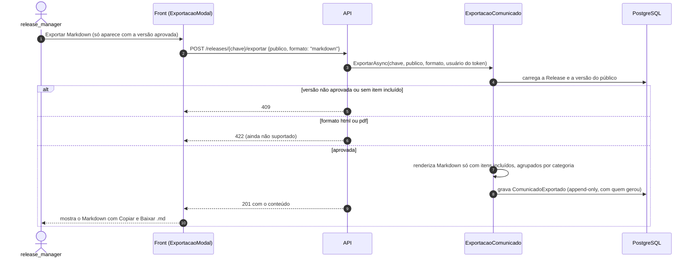

### 5.4 Login

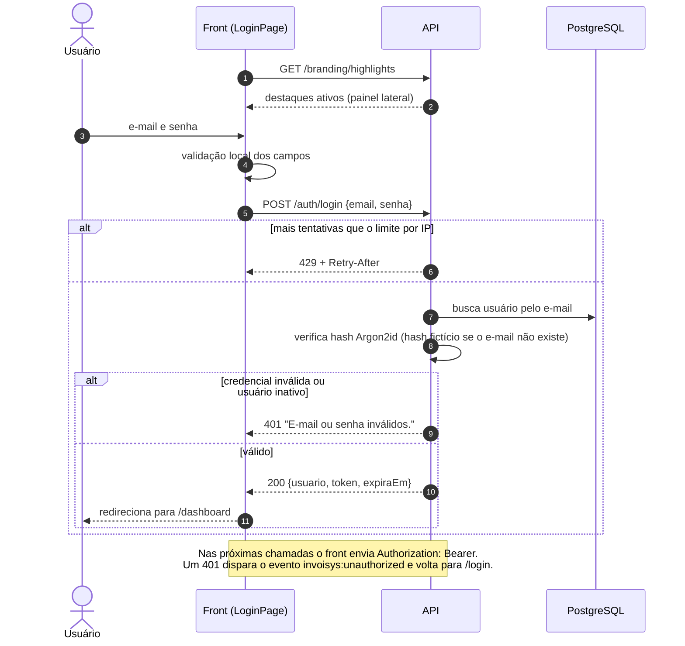

### 5.5 Recuperação de senha

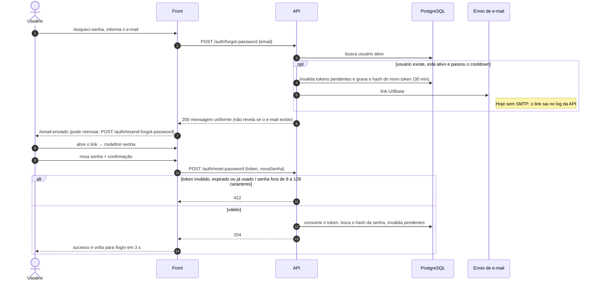

---

## 6. Diagramas de estados

Os dois ciclos de estado (geração da **Release** e revisão de cada **VersaoComunicado**)
estão desenhados e explicados em
[modelagem-de-dominio.md → Fluxo de estados](modelagem-de-dominio.md#fluxo-de-estados).
Eles não são repetidos aqui para não haver duas fontes que possam divergir.

---

## 7. Regras de negócio

Cada regra aponta onde é garantida. "Domínio" = a regra vive na entidade e vale para
qualquer caminho de entrada, não só para a API.

| Id | Regra | Onde é garantida | Resposta da API |
|---|---|---|---|
| RN-01 | Nenhum comunicado é exportado sem aprovação humana: só versão `aprovado` **com pelo menos um item incluído** pode ser exportada | Domínio: `VersaoComunicado.ProntaParaExportar`, checada no construtor de `ComunicadoExportado` | `409` |
| RN-02 | Versão aprovada não é reprocessada pela IA; é preciso reabrir antes | Domínio: `Release.GarantirQuePodeReprocessar`, `VersaoComunicado.PreencherConteudo` (ADR-020) | `409` |
| RN-03 | Item de versão aprovada não é editado, excluído nem reincluído; é preciso reabrir antes | Domínio: `VersaoComunicado.GarantirQuePodeAlterarItem` (ADR-021) | `409` |
| RN-04 | Item excluído não vai para a exportação; a exclusão não apaga o registro (pode ser reincluído) | Domínio: `ItemComunicado.Incluido`, `VersaoComunicado.ItensPublicaveis`, usado por `RenderizadorMarkdown` | — |
| RN-05 | Não se aprova versão sem itens nem versão com todos os itens excluídos | Domínio: `VersaoComunicado.Aprovar` | `409` |
| RN-06 | Só se aprova ou reprova versão em `aguardando_revisao`; só se reabre versão `aprovado` | Domínio: `VersaoComunicado.Aprovar/Reprovar/Reabrir` | `409` |
| RN-07 | Reprovar exige motivo | Domínio: `VersaoComunicado.Reprovar`; também validado na borda (`ReprovarInValidator`) | `422` |
| RN-08 | Release cujo pipeline falhou não pode ser aprovada | Domínio: `Release.Aprovar` | `409` |
| RN-09 | A revisão é por público: aprovar a versão `cliente` não aprova as outras. A Release só fica `aprovado` quando **todas** as versões existentes estão aprovadas | Domínio: `Release.Aprovar` | — |
| RN-10 | Toda decisão de revisão registra o revisor (vindo do token, nunca do corpo) e a data; revisor precisa estar ativo | Domínio: `VersaoComunicado.ExigirRevisor`; `RevisaoComunicado` / `UsuarioResponsavel` | `401` |
| RN-11 | Edição de item não aceita texto vazio (para tirar o item, exclui-se) | Domínio: `VersaoComunicado.EditarItem` | `422` |
| RN-12 | O texto exportado de um item é o editado pelo humano, se houver; senão o da IA | Domínio: `ItemComunicado.TextoFinal` | — |
| RN-13 | Categorias são fixas: `nova_funcionalidade`, `melhoria`, `correcao`, `outros`. Resposta da IA fora disso é recusada | Domínio: `CategoriaAlteracao`; `ChatCompletionsLlmProvider.CategorizarAsync` (ADR-018) | `502` |
| RN-14 | Quando a história tem subtarefa Release Note, o texto dela tem prioridade sobre a descrição técnica como fonte para a IA | Domínio: `HistoriaJira.TextoFonte` | — |
| RN-15 | Chave de história devolvida pela IA que não veio do Jira é descartada (não vira item) | Aplicação: `PipelineGeracaoReleaseNote.ProcessarGruposAsync` (ADR-017) | — |
| RN-16 | Release sem histórias no Jira é recusada antes de chamar a IA | Domínio: `Release.MarcarProcessando` (ADR-030) | `422` |
| RN-17 | A mesma Release não é processada em paralelo | Aplicação + infra: trava por chave (ADR-031) | `409` |
| RN-18 | Fonte de dados é só a API do Jira: não há entrada por JSON/CSV colado | Arquitetura (ADR-006) | — |
| RN-19 | Exportações são append-only: nunca alteradas nem apagadas, e registram quem gerou | `IComunicadoExportadoRepository` (só inclui e consulta) | — |
| RN-20 | Papéis válidos são só `admin` e `release_manager`; só admin gerencia usuários | Domínio: `Usuario.PapelEhValido`; policy `Admin` | `422` / `403` |
| RN-21 | Usuário não é apagado, é desativado; admin não desativa a si mesmo; usuário desativado perde o acesso mesmo com token ainda válido | `Usuario.Desativar`, `AdministracaoUsuarios`, `OnTokenValidated` | `422` / `401` |
| RN-22 | E-mail de usuário é único e normalizado (minúsculas, sem espaços nas pontas) | Domínio: `Usuario.NormalizarEmail`; `AdministracaoUsuarios` | `409` |
| RN-23 | Senha tem de 8 a 128 caracteres | Domínio: `Usuario.ValidarSenhaNova` | `422` |
| RN-24 | Token de redefinição de senha é de uso único, vale 30 minutos e é guardado só como hash; pedir um novo invalida os anteriores | Domínio: `TokenRedefinicaoSenha`; `RecuperacaoSenha` (ADR-025) | `422` |
| RN-25 | O pedido de recuperação responde igual exista ou não o e-mail | `RecuperacaoSenha.MensagemEnvio` | `200` |
| RN-26 | O admin inicial só é criado se **não existir nenhum** usuário e os três campos estiverem configurados | `AdminInicialSemeador` | — |

---

## 8. Telas

Uma subseção por tela de `frontend/src/pages`. As rotas estão em `frontend/src/App.jsx`.
Toda tela protegida usa o `Layout` (menu lateral e cabeçalho); 401 em qualquer chamada
devolve o usuário para `/login`.

Prints tirados em 18/11/2026 com o código da `develop` (o mesmo da `main` publicada), rodando localmente com dados de teste, numa janela de 1280×800. A tela de detalhe está em página inteira.

**Achado:** nas telas de recuperação de senha (8.2 a 8.4) o logotipo aparece quebrado. A imagem vem de um endereço do Google (`BRAND_LOGO_URL` em `frontend/src/utils/constants.js`) que hoje responde 403, inclusive no deploy.

### 8.1 Login — `LoginPage` (`/login`)

**Mostra:** logotipo, formulário de e-mail e senha, painel lateral com os destaques
cadastrados (`GET /branding/highlights`), com estados de carregando, erro (com "tentar
de novo") e vazio.

**Ações:** entrar (`POST /auth/login`; erros de campo do `422` aparecem em cada campo,
`401` aparece em alerta); ir para "Esqueci minha senha". Usuário já autenticado é
redirecionado para o dashboard.

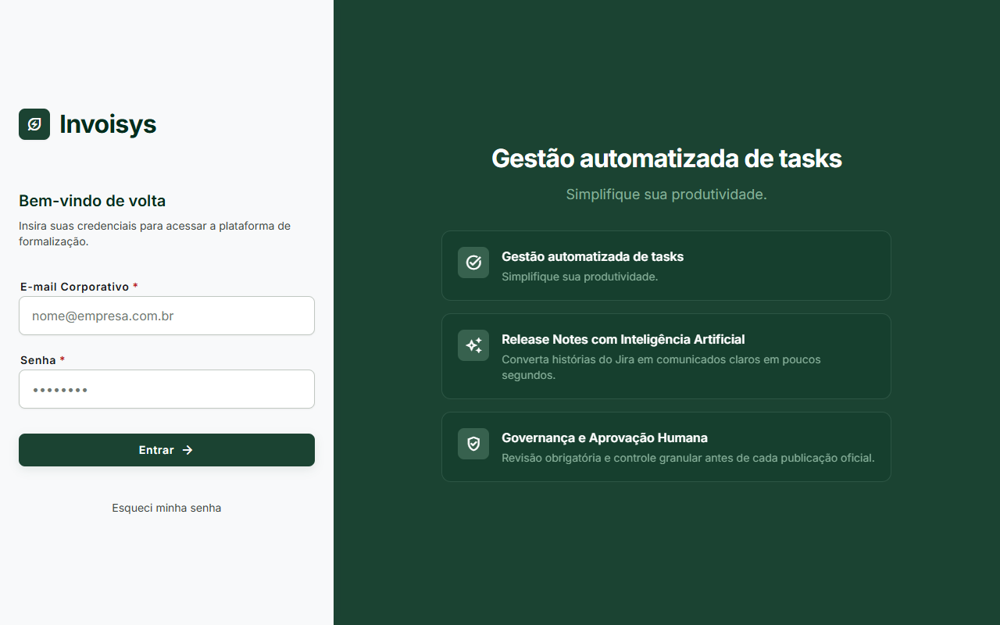

### 8.2 Esqueci a senha — `ForgotPasswordPage` (`/esqueci-senha`)

**Mostra:** campo de e-mail corporativo, instruções e rodapé institucional.

**Ações:** enviar o link (`POST /auth/forgot-password`), com validação local de e-mail
vazio ou inválido; voltar para o login.

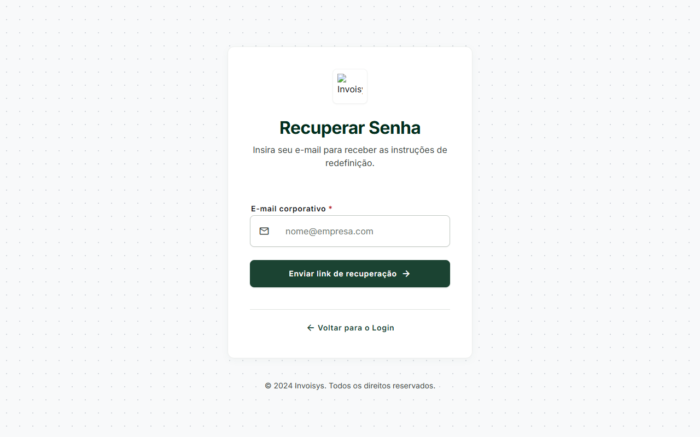

### 8.3 E-mail enviado — `EmailConfirmationPage` (`/email-enviado`)

**Mostra:** confirmação de envio com o e-mail informado, a mensagem uniforme da API e a
validade do link em minutos.

**Ações:** reenviar o link (`POST /auth/resend-forgot-password`), com feedback de sucesso
ou erro; voltar para o login.

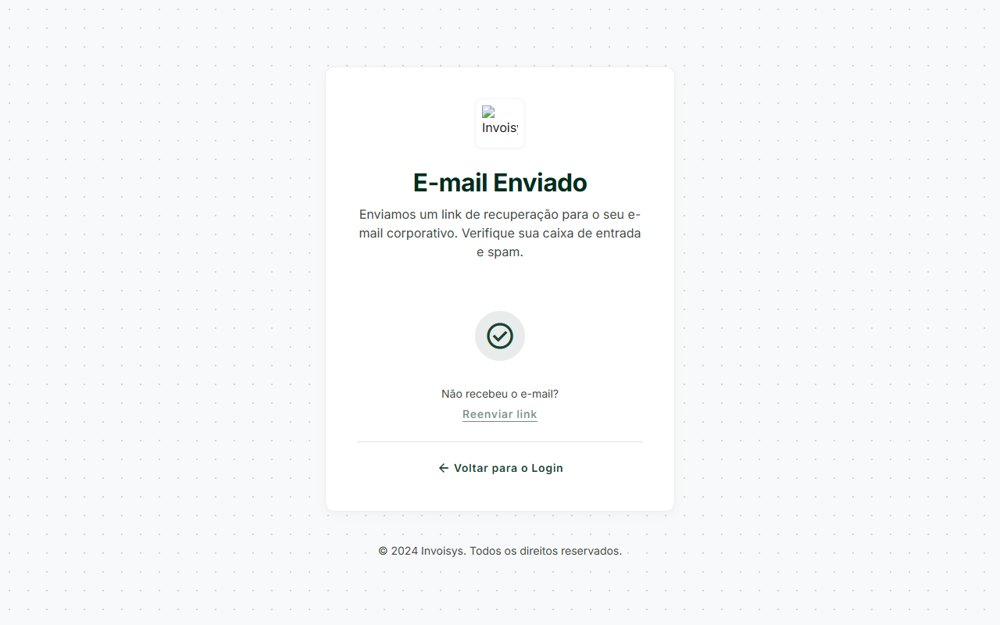

### 8.4 Redefinir senha — `ResetPasswordPage` (`/redefinir-senha#token=...`)

**Mostra:** campos de nova senha e confirmação, com opção de mostrar a senha. O token é lido
do fragmento da URL (`#token=`, com `?token=` como alternativa) e retirado da barra de
endereço. Sem token, a tela informa que o link é inválido.

**Ações:** salvar a nova senha (`POST /auth/reset-password`), com validação local de 8
caracteres e confirmação igual; em caso de sucesso, volta para o login após 3 segundos.

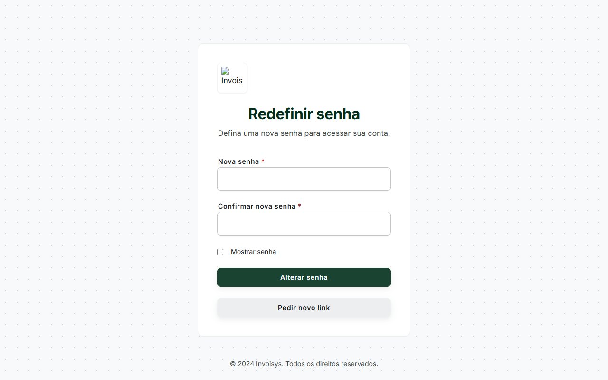

### 8.5 Dashboard — `DashboardPage` (`/dashboard`)

**Mostra:** cartões de indicadores (Cards Formalizados, Em Revisão, Exportados), gráfico
de produtividade dos últimos dias, bloco "qualidade da IA" (percentual de itens editados e
excluídos sobre os gerados) e tabela das Releases recentes (`GET /dashboard`). Sem dados,
mostra um estado vazio com atalho para Releases.

**Ações:** abrir uma Release recente (vai para o detalhe); tentar de novo em caso de erro.

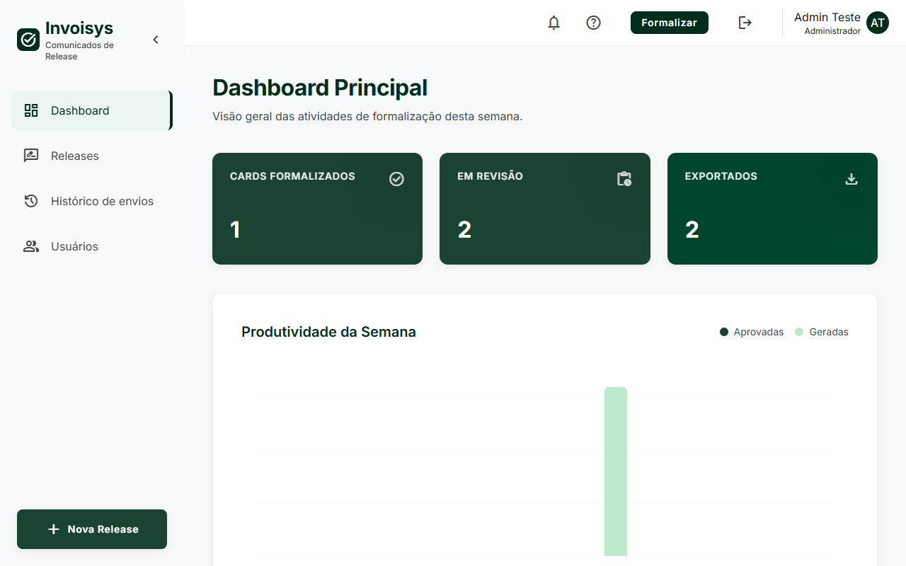

### 8.6 Releases — `ReleasesPage` (`/releases`)

**Mostra:** tabela com chave, status (selo colorido) e data de criação das Releases
processadas (`GET /releases`), paginada no cliente, com abas de filtro: Todas, Aguardando
revisão, Aprovadas, Falharam, Pendentes (`?status=`).

**Ações:** filtrar por status; paginar; abrir o detalhe de uma Release; **Processar
Release**, que abre o modal `ProcessarReleaseModal` para informar a chave da Release
(fixVersion do Jira) e chama `POST /releases/{chave}/processar` (o modal avisa que a
operação pode demorar). O modal também abre com `?nova=1` na URL.

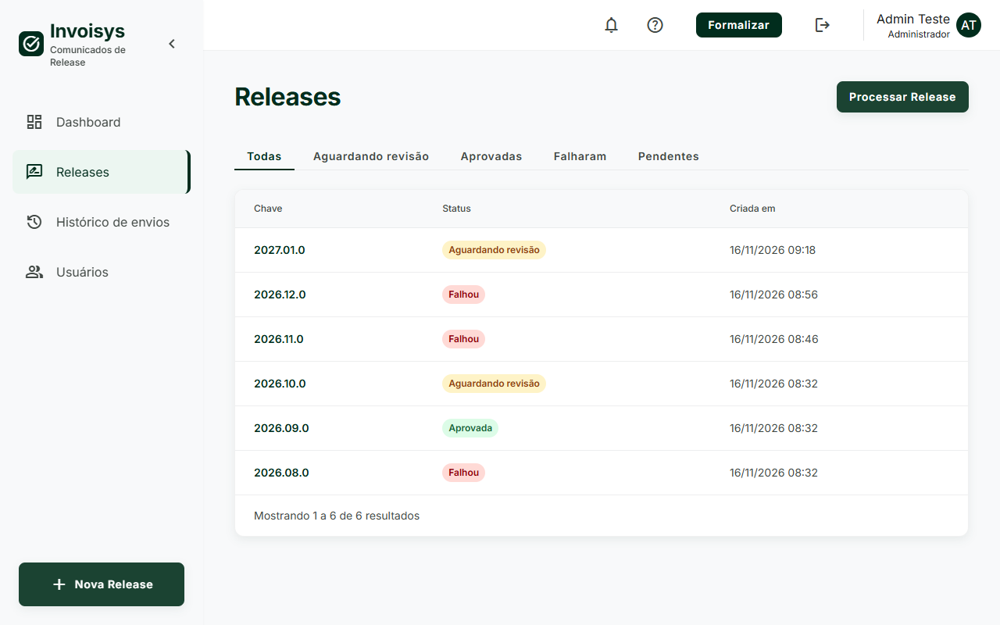

### 8.7 Detalhe da Release — `ReleaseDetalhePage` (`/releases/:chave`)

**Mostra:** chave e status da Release; uma aba por público com versão gerada (com selo de
status da versão); na aba, título e resumo executivo e os itens agrupados por categoria
(Novas Funcionalidades, Melhorias, Correções, Outros), indicando item editado à mão, item
excluído (riscado, com motivo) e as histórias de origem; painel lateral recolhível com as
histórias do Jira (marcando as que têm Release Note dedicada) e o histórico de execuções
do pipeline (status, modelo, início, duração). Sem versão gerada, mostra o erro da última
execução. Trata 404 ("Release não encontrada").

**Ações** (só aparecem quando o status da versão permite, espelhando o domínio em
`utils/revisao.js`):

| Status da versão | Ações |
|---|---|
| `aguardando_revisao` | editar, excluir (com motivo) e reincluir item; Aprovar (desabilitado sem item incluído, e oculto se o pipeline falhou); Reprovar (motivo obrigatório); Reprocessar com IA |
| `aprovado` | Reabrir; Exportar Markdown (abre modal com o conteúdo, **Copiar** e **Baixar .md**) |
| `reprovado` | Reprocessar com IA |

Aprovar, Reabrir e Reprocessar pedem confirmação em diálogo.

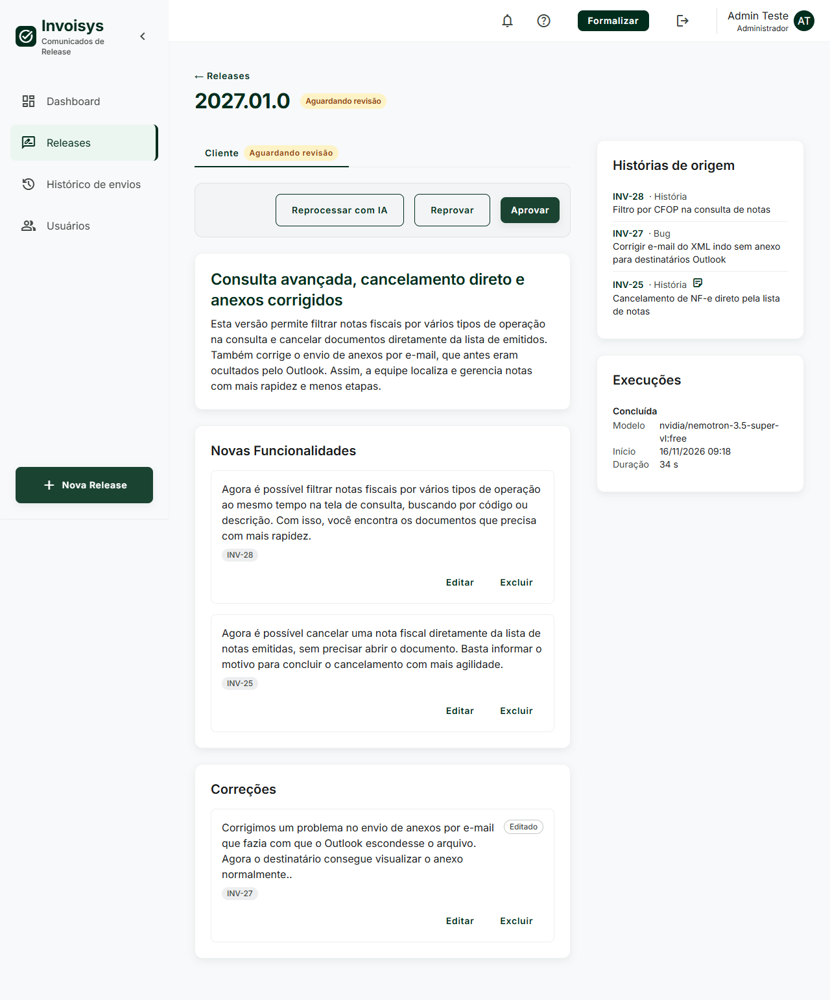

### 8.8 Histórico de Envios — `SentHistoryPage` (`/historico`)

**Mostra:** lista paginada de comunicados formalizados com filtros por texto, período,
tom e status. **Atenção:** a tela ainda usa dados de exemplo
(`frontend/src/data/sentHistory.mock.js`); a integração com `GET /exportacoes` não foi
feita.

**Ações:** filtrar, limpar filtros, paginar. O botão "Exportar log" ainda não tem ação
ligada à API.

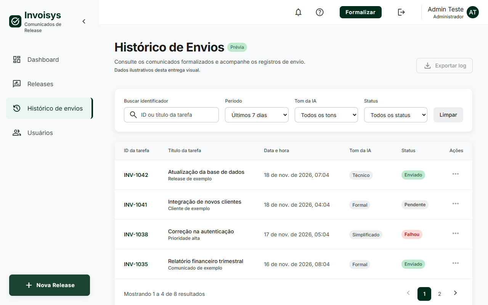

### 8.9 Meu Perfil — `ProfilePage` (`/perfil`)

**Mostra:** nome, papel, e-mail e data de cadastro do usuário autenticado
(`GET /auth/me`), somente leitura.

**Ações:** voltar para a tela anterior.

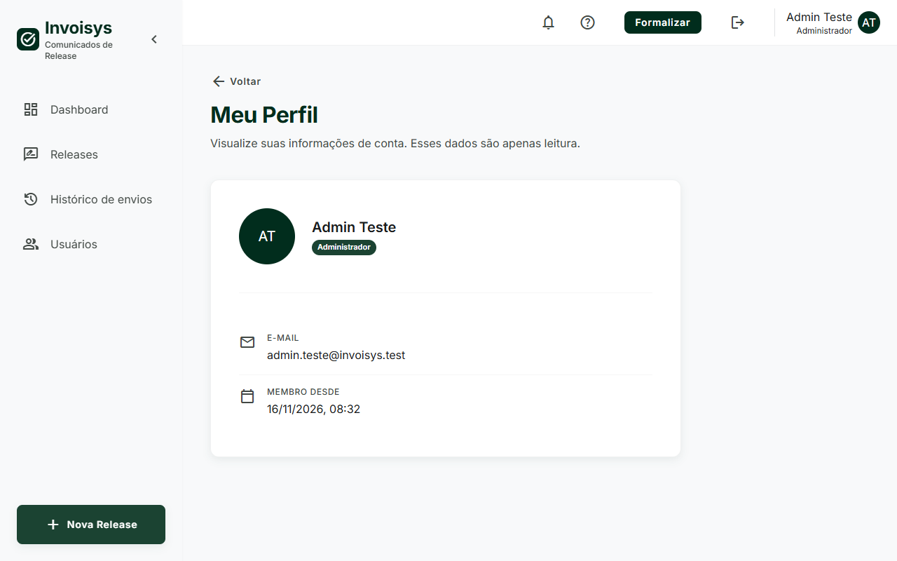

### 8.10 Gestão de Usuários — `UserManagementPage` (`/usuarios`, só admin)

**Mostra:** lista de usuários (`GET /usuarios`) com estados de carregando, erro e vazio;
ao selecionar um usuário, painel com os dados dele.

**Ações:** selecionar usuário; desativar usuário (`POST /usuarios/{id}/desativar`), exceto
a própria conta; ir para "Novo Usuário".

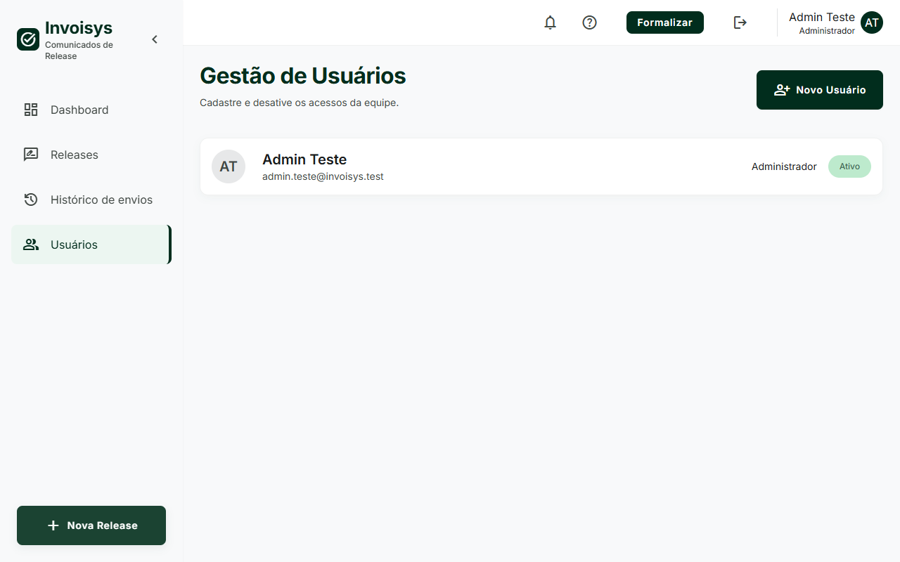

### 8.11 Novo Usuário — `CreateUserPage` (`/usuarios/novo`, só admin)

**Mostra:** formulário com nome completo, e-mail corporativo, papel (Administrador ou
Release Manager, com descrição de cada um) e senha inicial.

**Ações:** cadastrar (`POST /usuarios`; e-mail duplicado volta como erro `409`); ao
concluir, volta para a lista de usuários.

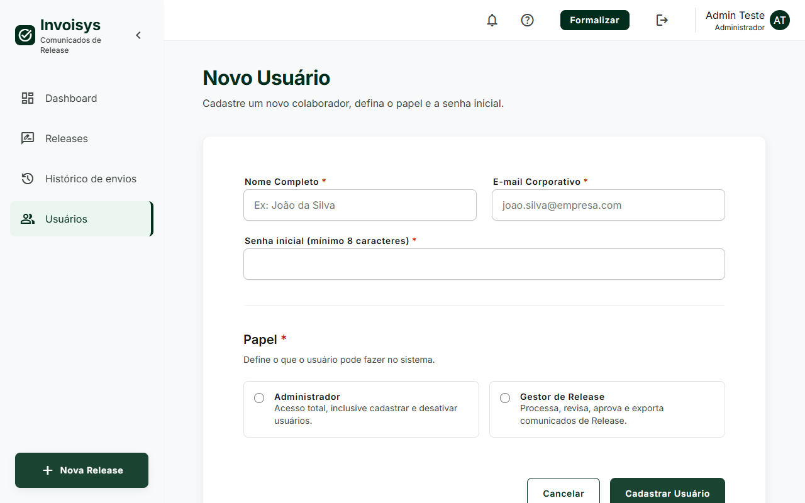

### 8.12 Em construção — `UnderConstructionPage`

**Mostra:** aviso genérico "Tela em manutenção" com o título recebido. Hoje **não está
ligada a nenhuma rota** em `App.jsx`; fica disponível para telas futuras.

**Ações:** nenhuma além da navegação do `Layout`.

> Sem print: a tela não está ligada a nenhuma rota, então não aparece no sistema.
